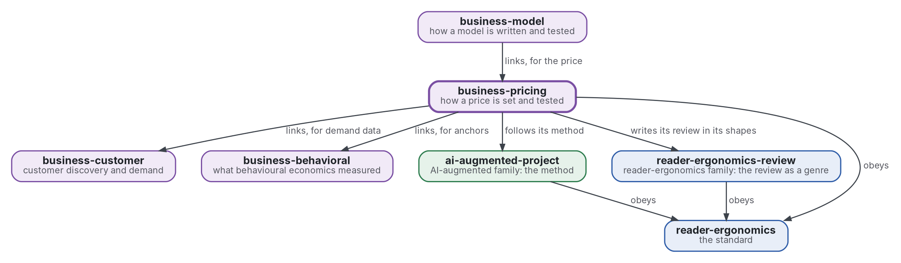

# Fixation des prix

[](https://github.com/Tewf/business-pricing/actions/workflows/checks.yml)
[](https://tewf.github.io/business-pricing/)

Comment un prix se fixe et se teste : la **disposition à payer** et sa mesure, le prix personnalisé avec son droit et son éthique, les ancres et les prix de référence. Un programme estime la disposition à payer à partir de données d'enquête.

Cette page en anglais : [README.md](README.md). Les deux versions suivent le même état.

> **État (2026-11-04) :** mis en place ; rien n'est encore écrit au-delà du périmètre. Le premier travail est une revue
> de littérature, non commencée. Le nom est provisoire jusqu'à ce que la première étape de cette revue dise comment le
> domaine nomme la chose. Ce n'est ni une norme officielle, ni une étude relue par des pairs, ni un résultat nouveau.
>
> **Comment il est fait :** avec Claude, un assistant IA d'Anthropic, sous la direction du mainteneur, comme
> reader-ergonomics. Les corrections sont bienvenues sous forme d'issues.

## Où il se place


<details>
<summary>Graphviz source</summary>



</details>

- **Il lie [business-customer](https://github.com/Tewf/business-customer)** pour les données de demande dont on lit un prix, et **[business-behavioral](https://github.com/Tewf/business-behavioral)** pour le statut de réplication de l'ancrage et du cadrage.
- **[business-model](https://github.com/Tewf/business-model) le lie** pour le prix ; ce dépôt ne dépend pas du modèle.
- **Sa méthode est celle d'[ai-augmented-project](https://github.com/Tewf/ai-augmented-project)** : cadrer, revoir, fixer une référence et planifier, et les registres des décisions et des valeurs provisoires. Il ne dépend pas des autres parties de ce dépôt.
- **Il écrit sa revue dans les formes de [reader-ergonomics-review](https://github.com/Tewf/reader-ergonomics-review)**, la revue comme genre ; les formes sont celles de ce dépôt.
- **Il obéit à [reader-ergonomics](https://github.com/Tewf/reader-ergonomics/blob/2e5b6f0c3e67d2dc8195a63cf882d46170e79a5a/standard.md)** (v1.21.0) et exécute ses vérifications en CI.
- **Il ne pointe que vers le bas.** La carte de la famille est [business](https://github.com/Tewf/business). Une entreprise n'apparaît ici que comme exemple, jamais comme sujet.

## Périmètre

| | Quoi | Pourquoi |
|---|---|---|
| dedans | les manières de mesurer la disposition à payer : Van Westendorp, Gabor-Granger et l'analyse conjointe | chacune donne un objet différent, une fourchette, une courbe ou un arbitrage, et un prix choisi à partir de l'une doit dire laquelle |
| dedans | la mesure incitative : une enchère ou une précommande réelle face à une réponse déclarée | ce que les gens disent et ce qu'ils paient diffèrent, et seul un acte coûteux prouve un paiement |
| dedans | la prime d'un bien conçu soi-même face au même bien en rayon, et sa mesure avant toute vente | l'effet est documenté (le sentiment d'accomplissement, le plaisir du processus) ; on le mesure, on ne le suppose pas |
| dedans | comment lire une liste d'attente comme preuve de demande | une inscription ne coûte rien, donc elle surestime la demande, et la revue dit de combien |
| dedans | la discrimination par les prix et le prix personnalisé, avec leur droit et leur éthique | un prix qui dépend de la personne soulève des questions de protection du consommateur et des données auxquelles un vendeur doit répondre d'abord |
| dedans | les ancres et les prix de référence tels qu'ils agissent sur un prix | le nombre qu'un acheteur voit d'abord déplace celui qu'il accepte, et une grille de prix est une ancre qu'on le veuille ou non |
| dedans | un programme qui estime la disposition à payer à partir de données d'enquête | une méthode que personne ne peut exécuter sur des données n'est pas encore une réponse |
| plus tard | des tests de prix sur des ventes réelles | ils demandent des ventes, ce que n'a pas un squelette |
| dehors | l'estimation de la demande à partir de choix, et le plan d'une étude client | [business-customer](https://github.com/Tewf/business-customer) |
| dehors | la réplication d'un effet, et la ligne entre une incitation et un motif trompeur | [business-behavioral](https://github.com/Tewf/business-behavioral) |

## Le premier travail : une revue de littérature

Non commencée. Elle suit l'ordre d'une revue de thèse, et elle est finie quand elle peut nommer la référence.

1. **Cadrer :** le problème en une phrase, et comment chaque domaine le nomme. Pistes à vérifier : la disposition à payer dans les manuels d'économie industrielle. La littérature de l'analyse conjointe. La littérature des outils de conception par le client (Franke et Piller 2004 ; Franke, Schreier et Kaiser 2010 ; Franke et Hader 2014). Van Westendorp 1976 comme simple fourchette. Les synthèses de tarification comportementale. Le dépôt peut être renommé alors.
2. **Revue :** chaque nom, cherché par son nom académique, son acronyme et son auteur ; les synthèses d'abord.
   - chaque mesure de la disposition à payer, par son nom académique, son acronyme et son auteur, les synthèses d'abord ;
   - les mesures déclarées et incitatives comparées sur le même bien, et l'écart qu'elles laissent ;
   - la prime de la conception par soi-même dans la source, avec la manière dont elle a été mesurée (évaluation contingente, enchères) ;
   - le droit du prix personnalisé là où le mainteneur vend, trouvé dans les textes et non supposé.
3. **État de l'art, et le dossier contre.**
4. **Positionnement :** ce que ce dépôt demande et que le domaine ne répond pas déjà.
5. **Référence :** un programme d'estimation de la disposition à payer à partir de données d'enquête. Il est comparé à la mesure incitative, qui est celle qui compte, et à la fourchette de Van Westendorp, qui est la pratique.

## Questions auxquelles la revue doit répondre

- **Mesure.** Quelle mesure de la disposition à payer prédit ce que les gens paient vraiment, et de combien une réponse déclarée se trompe-t-elle ?
- **Prime.** Quelle est la prime d'un bien conçu soi-même face au même bien en rayon, et quand disparaît-elle ?
- **Liste d'attente.** Que dit une liste d'attente de la demande, et que faut-il enregistrer pour qu'elle en dise plus ?
- **Limites.** Où le droit et l'éthique empêchent-ils un vendeur de montrer deux prix à deux personnes ?

## Vérifier

```sh
git clone https://github.com/Tewf/reader-ergonomics
python3 reader-ergonomics/checks/run.py chemin/vers/ce/depot
```

La CI exécute les mêmes vérifications à chaque push, et une exécution échoue à la première erreur
([checks.yml](https://github.com/Tewf/business-pricing/blob/master/.github/workflows/checks.yml)). Chaque push sur
master construit aussi le site, [tewf.github.io/business-pricing](https://tewf.github.io/business-pricing/)
([pages.yml](https://github.com/Tewf/business-pricing/blob/master/.github/workflows/pages.yml)).

## Contenu

| Partie | Résumé |
|---|---|
| [decisions](decisions/) | une fiche par choix qui façonne ce dépôt, chacune ouvrant sur la décision en une phrase |

## Licence

Code sous [Apache License 2.0](LICENSE) ; prose sous [CC BY 4.0](LICENSES/CC-BY-4.0.txt). Réutilisez-le comme vous le
souhaitez, en créditant ce dépôt ; [CITATION.cff](CITATION.cff) donne une citation si besoin.
