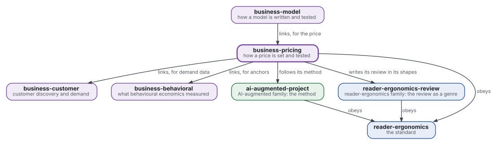
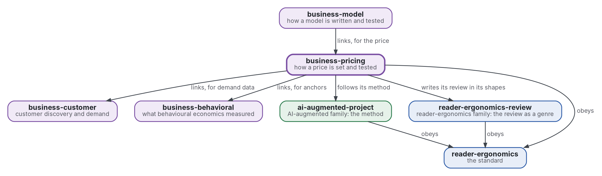

# Fixation des prix

[](https://github.com/Tewf/business-pricing/actions/workflows/checks.yml)
[](https://tewf.github.io/business-pricing/)

Comment un prix se fixe et se teste : la **disposition à payer** et sa mesure, le prix personnalisé avec son droit et son éthique, les ancres et les prix de référence. Un programme estime la disposition à payer à partir de données d'enquête.

Cette page en anglais : [README.md](README.md). Les deux versions suivent le même état.

> **État (2026-11-04) :** la première revue est écrite, en première passe sur 39 sources, et se termine sur une
> référence nommée, B1. Un programme calcule la fourchette de Van Westendorp et une courbe de Gabor-Granger à partir de
> lignes d'enquête. Le nom est gardé après l'étape de cadrage
> ([fiche 0002](decisions/0002-keep-the-name-and-measure-a-stated-range-against-a-paid-one.md)). Ce n'est ni une norme
> officielle, ni une étude relue par des pairs, ni un résultat nouveau.
>
> **Comment il est fait :** avec Claude, un assistant IA d'Anthropic, sous la direction du mainteneur, comme
> reader-ergonomics. Les corrections sont bienvenues sous forme d'issues.

## Où il se place



<details>
<summary>Graphviz source</summary>



</details>

- **Il lie [business-customer](https://github.com/Tewf/business-customer)** pour les données de demande dont on lit un prix, et **[business-behavioral](https://github.com/Tewf/business-behavioral)** pour le statut de réplication de l'ancrage et du cadrage.
- **[business-model](https://github.com/Tewf/business-model) le lie** pour le prix ; ce dépôt ne dépend pas du modèle.
- **Sa méthode est celle d'[ai-augmented-project](https://github.com/Tewf/ai-augmented-project)** : cadrer, revoir, fixer une référence et planifier, et les registres des décisions et des valeurs provisoires. Il ne dépend pas des autres parties de ce dépôt.
- **Il écrit sa revue dans les formes de [reader-ergonomics-review](https://github.com/Tewf/reader-ergonomics-review)**, la revue comme genre ; les formes sont celles de ce dépôt.
- **Il obéit à [reader-ergonomics](https://github.com/Tewf/reader-ergonomics/blob/2e5b6f0c3e67d2dc8195a63cf882d46170e79a5a/standard.md)** (v1.21.0) et exécute ses vérifications en CI.
- **Il ne pointe que vers le bas.** La carte de la famille est [business](https://github.com/Tewf/business). Une entreprise n'apparaît ici que comme exemple, jamais comme sujet.

## Périmètre

| | Quoi | Pourquoi |
|---|---|---|
| dedans | les manières de mesurer la disposition à payer : Van Westendorp, Gabor-Granger et l'analyse conjointe | chacune donne un objet différent, une fourchette, une courbe ou un arbitrage, et un prix choisi à partir de l'une doit dire laquelle |
| dedans | la mesure incitative : une enchère ou une précommande réelle face à une réponse déclarée | ce que les gens disent et ce qu'ils paient diffèrent, et seul un acte coûteux prouve un paiement |
| dedans | la prime d'un bien conçu soi-même face au même bien en rayon, et sa mesure avant toute vente | l'effet est documenté (le sentiment d'accomplissement, le plaisir du processus) ; on le mesure, on ne le suppose pas |
| dedans | comment lire une liste d'attente comme preuve de demande | une inscription ne coûte rien, donc elle surestime la demande, et la revue dit de combien |
| dedans | la discrimination par les prix et le prix personnalisé, avec leur droit et leur éthique | un prix qui dépend de la personne soulève des questions de protection du consommateur et des données auxquelles un vendeur doit répondre d'abord |
| dedans | les ancres et les prix de référence tels qu'ils agissent sur un prix | le nombre qu'un acheteur voit d'abord déplace celui qu'il accepte, et une grille de prix est une ancre qu'on le veuille ou non |
| dedans | un programme qui estime la disposition à payer à partir de données d'enquête | une méthode que personne ne peut exécuter sur des données n'est pas encore une réponse |
| plus tard | des tests de prix sur des ventes réelles | ils demandent des ventes, ce que n'a pas un squelette |
| dehors | l'estimation de la demande à partir de choix, et le plan d'une étude client | [business-customer](https://github.com/Tewf/business-customer) |
| dehors | la réplication d'un effet, et la ligne entre une incitation et un motif trompeur | [business-behavioral](https://github.com/Tewf/business-behavioral) |

## Le premier travail : une revue de littérature

Fait en première passe le 2026-11-04, dans les cinq étapes d'une revue de thèse : [evidence/willingness-to-pay](evidence/willingness-to-pay/README.md) (en anglais). Elle compte 39 sources, 30 formelles et 9 grises, et la plupart des chiffres sont lus dans les résumés et marqués comme tels.

## Ce que la revue a trouvé

- **Le domaine nomme cela la mesure de la disposition à payer** (willingness to pay). Son écart entre une réponse déclarée et une réponse payée est le biais hypothétique. « Fixation des prix » est plus large : le nom correspond en partie et reste.
- **Une réponse déclarée surestime une réponse payée.** Le dépassement moyen est de 21 % pour les biens de consommation sur 77 études (Schmidt 2020, secondaire). Le rapport médian est de 1,35 sur 83 observations (Murphy 2005). Les méthodes indirectes comme l'analyse conjointe surestiment plus que les questions directes. Une enchère n'a guère réduit le biais face à un vote par référendum (Penn 2018, secondaire).
- **La prime de conception par soi-même est mesurée entre +37 % et +92 % chez des étudiants, et disparaît quand la tâche n'est pas finie.**
  - Dans des offres BDM d'étudiants en gestion, le même motif de T-shirt valait 44 % de plus conçu qu'en rayon, et un motif de ski 62 % de plus (Franke 2010, lu en entier).
  - Elle était de +92 % pour un motif qui plaisait et de +37 % pour un autre. Plus de liberté de conception a fait passer l'offre pour un cadran de montre de 19,21 à 30,34 euros, et qui offrait sur un autre motif ne payait aucune prime.
  - Les montres ont montré environ +100 % par évaluation contingente et enchères de Vickrey (Franke 2004, secondaire). L'effet demande une tâche terminée (Norton 2012, secondaire).
  - Conditions : des étudiants, des biens de moins de 100 euros environ, des offres en salle de cours. Aucune prime mesurée sur de vrais acheteurs dans une vraie vente n'a été trouvée.
- **Aucune étude d'une liste d'attente comme preuve de demande n'a été trouvée.** Le plus proche est l'intention d'achat déclarée, qui a battu une extrapolation des ventes passées pour des produits existants (Armstrong 2000). Une inscription gratuite est une intention déclarée sans prix.
- **Deux prix pour deux personnes demandent une information dans l'UE.** Un prix personnalisé doit être signalé le cas échéant (EU 2019 Directive, article 4). Une décision fondée uniquement sur un traitement automatisé à effet important exige un contrat, une loi ou un consentement explicite (EU 2016 GDPR, article 22). Le droit d'un État membre n'a pas été lu.

## La référence

**B1** est une fourchette déclarée, vérifiée contre une mesure payée sur le même bien ([baseline](evidence/willingness-to-pay/baseline.md), en anglais).

- un échantillon répond aux quatre prix de Van Westendorp et à une échelle de Gabor-Granger, lues par `checks/local/wtp_range.py` ;
- un second échantillon fait une offre BDM avec un vrai tirage, ou précommande avec un petit acompte ;
- le biais hypothétique est donné en rapport, et le chiffre payé est celui qui compte.

Il manque de vrais acheteurs à la place des étudiants, un second bras payé, et une étude de la liste d'attente.

## Questions auxquelles la revue doit répondre

- **Mesure.** Quelle mesure de la disposition à payer prédit ce que les gens paient vraiment, et de combien une réponse déclarée se trompe-t-elle ?
- **Prime.** Quelle est la prime d'un bien conçu soi-même face au même bien en rayon, et quand disparaît-elle ?
- **Liste d'attente.** Que dit une liste d'attente de la demande, et que faut-il enregistrer pour qu'elle en dise plus ?
- **Limites.** Où le droit et l'éthique empêchent-ils un vendeur de montrer deux prix à deux personnes ?

## Vérifier

```sh
git clone https://github.com/Tewf/reader-ergonomics
python3 reader-ergonomics/checks/run.py chemin/vers/ce/depot
```

La CI exécute les mêmes vérifications à chaque push, et une exécution échoue à la première erreur
([checks.yml](https://github.com/Tewf/business-pricing/blob/master/.github/workflows/checks.yml)). Chaque push sur
master construit aussi le site, [tewf.github.io/business-pricing](https://tewf.github.io/business-pricing/)
([pages.yml](https://github.com/Tewf/business-pricing/blob/master/.github/workflows/pages.yml)).

## Contenu

| Partie | Résumé |
|---|---|
| [evidence](evidence/) | la première revue, sur la disposition à payer : cinq étapes, 39 sources, une référence nommée (en anglais) |
| [decisions](decisions/) | une fiche par choix qui façonne ce dépôt, chacune ouvrant sur la décision en une phrase |
| [checks/local](checks/local/wtp_range.py) | un programme pour la fourchette de Van Westendorp et une courbe de Gabor-Granger, avec ses tests |

## Licence

Code sous [Apache License 2.0](LICENSE) ; prose sous [CC BY 4.0](LICENSES/CC-BY-4.0.txt). Réutilisez-le comme vous le
souhaitez, en créditant ce dépôt ; [CITATION.cff](CITATION.cff) donne une citation si besoin.
