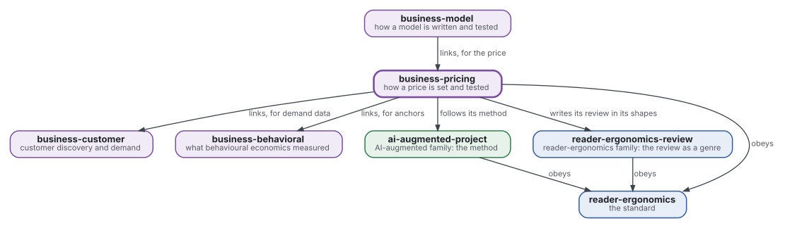
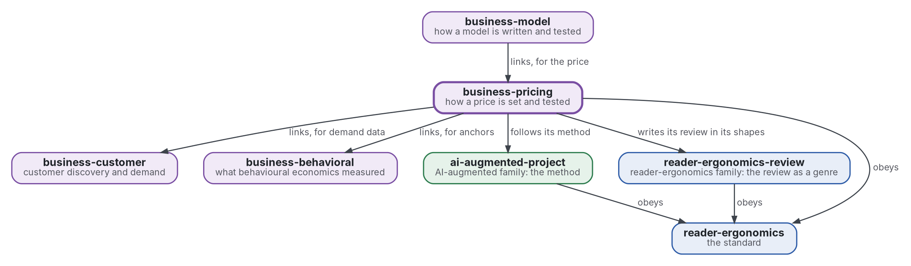

# Pricing

[](https://github.com/Tewf/business-pricing/actions/workflows/checks.yml)
[](https://tewf.github.io/business-pricing/)

How a price is set and tested: **willingness to pay** and how it is measured, personalised pricing with its law and its ethics, and anchors and reference prices. A program estimates willingness to pay from survey data.

This page in French: [README.fr.md](README.fr.md).

> **Status (2026-11-04):** set up; nothing is written yet beyond the scope. The first job is a literature review, not
> started. The name is provisional until that review's first step says what the field calls this. It is not an
> official standard, not a peer-reviewed study and not a new result.
>
> **How it is made:** with Claude, an AI assistant by Anthropic, under the maintainer's direction, the way
> reader-ergonomics was made. Corrections are welcome as issues.

## Where it sits



<details>
<summary>Graphviz source</summary>



</details>

- **It links [business-customer](https://github.com/Tewf/business-customer)** for the demand data a price is read from, and **[business-behavioral](https://github.com/Tewf/business-behavioral)** for the replication status of anchoring and framing.
- **[business-model](https://github.com/Tewf/business-model) links it** for the price; this repository does not depend on the model.
- **Its method is [ai-augmented-project](https://github.com/Tewf/ai-augmented-project)'s**: scope, review, baseline and plan, and the registers of decisions and of provisional values. It does not depend on that repository's other parts.
- **It writes its review in the shapes of [reader-ergonomics-review](https://github.com/Tewf/reader-ergonomics-review)**, the review as a genre; the shapes are that repository's.
- **It obeys [reader-ergonomics](https://github.com/Tewf/reader-ergonomics/blob/2e5b6f0c3e67d2dc8195a63cf882d46170e79a5a/standard.md)** (v1.21.0) and runs its checks in CI.
- **It links down only.** The family's map is [business](https://github.com/Tewf/business). A venture appears here as an example, never as the subject.

## Scope

| | What | Why |
|---|---|---|
| in | ways to measure willingness to pay: Van Westendorp, Gabor-Granger and conjoint analysis | each gives a different object, a range, a curve or a trade-off, and a price chosen from one must say which |
| in | the incentive-compatible measure: an auction or a real pre-order set against a stated answer | what people say and what they pay differ, and only a costly act counts as evidence of payment |
| in | the premium for a self-designed good against the same good off the shelf, and its measure before any sale | the effect is documented (a sense of accomplishment, the joy of the process), so it is measured, not assumed |
| in | how a waiting list is read as evidence of demand | a sign-up costs nothing, so it overstates demand, and the review says by how much |
| in | price discrimination and personalised pricing, with their law and their ethics | a price that depends on the person raises questions of consumer and data protection that a seller must answer first |
| in | anchors and reference prices as they act on a price | the number a buyer sees first moves the number they accept, and a price list is an anchor whether it is meant to be or not |
| in | a program that estimates willingness to pay from survey data | a method nobody can run on data is not yet an answer |
| later | price tests on live sales | they need sales, which a skeleton has not |
| out | the estimation of demand from choices, and the design of a customer study | [business-customer](https://github.com/Tewf/business-customer) |
| out | whether an effect replicates, and the line between a nudge and a dark pattern | [business-behavioral](https://github.com/Tewf/business-behavioral) |

## The first job: a literature review

Not started. It follows the order of a thesis review, and it is finished when it can name the baseline.

1. **Frame:** the problem in one sentence, and what each field calls it. Leads to verify: willingness to pay in the industrial-organisation texts. The conjoint literature. The toolkit literature on self-design (Franke and Piller 2004; Franke, Schreier and Kaiser 2010; Franke and Hader 2014). Van Westendorp 1976 as a bounded range only. Behavioural pricing reviews. The repository may be renamed then.
2. **Review:** each name, searched by its academic name, its acronym and its author; surveys first.
   - each measure of willingness to pay, by its academic name, its acronym and its author, surveys first;
   - stated and incentive-compatible measures compared on the same good, and the gap they leave;
   - the self-design premium in the source, with how it was measured (contingent valuation, auctions);
   - the law of personalised pricing in the places the maintainer sells in, found in the texts and not assumed.
3. **State of the art, and the case against.**
4. **Position:** what this repository asks that the field does not already answer.
5. **Baseline:** a program for a willingness-to-pay estimate from survey data, compared with the incentive-compatible measure as the one that counts, and with Van Westendorp's range as the practice.

## Questions the review must answer

- **Measure.** Which measure of willingness to pay predicts what people really pay, and by how much does a stated answer miss?
- **Premium.** How large is the premium for a self-designed good against the same good off the shelf, and when does it vanish?
- **Waiting list.** What does a waiting list say about demand, and what must be recorded for it to say more?
- **Limits.** Where do law and ethics stop a seller from showing two people two prices?

## Check it

```sh
git clone https://github.com/Tewf/reader-ergonomics
python3 reader-ergonomics/checks/run.py path/to/this/repository
```

CI runs the same checks on every push, and a run fails on any error
([checks.yml](https://github.com/Tewf/business-pricing/blob/master/.github/workflows/checks.yml)). Every push to
master also renders the site, [tewf.github.io/business-pricing](https://tewf.github.io/business-pricing/)
([pages.yml](https://github.com/Tewf/business-pricing/blob/master/.github/workflows/pages.yml)).

## Contents

| Part | Summary |
|---|---|
| [decisions](decisions/) | one record per choice that shapes this repository, each opening with the decision in one sentence |

## Licence

Code under the [Apache License 2.0](LICENSE); prose under [CC BY 4.0](LICENSES/CC-BY-4.0.txt). Reuse it as you wish,
with credit to this repository; [CITATION.cff](CITATION.cff) gives a citation if you need one.
