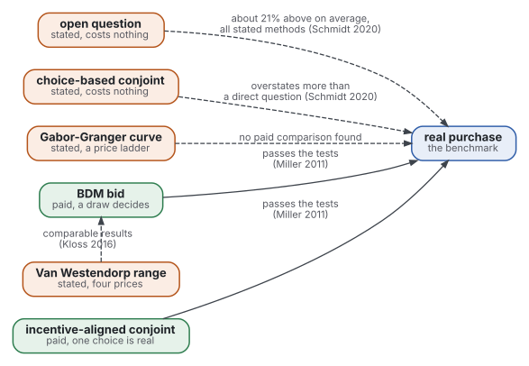
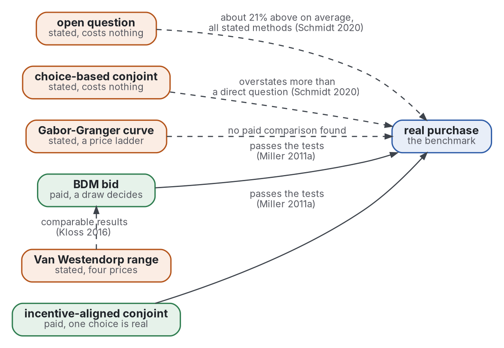

# Review: seven strands

Step 2 of the review, read on 2026-11-04. It groups the 39 sources by strand and answers Q1 to Q5 of [frame](frame.md). Surveys first in each strand.

**Shape:** [review](https://github.com/Tewf/reader-ergonomics-review/blob/c43f2770000a9af5c2aa3cbc6f997da7a7e13b34/shapes/review.md)

- Each key is in the [bibliography](../bibliography.md).
- Grades are the standard's four.
- A figure read in an abstract is marked (secondary).

Graphviz source

Orange is a stated answer, green a paid one and blue the benchmark. A dashed line is a stated answer and its gap; a solid line is a pass.

## Strand 0: existing reviews

- On average the stated figure for a consumer good was 21% above the real one, over 77 studies and 115 effect sizes (Schmidt 2020, abstract, secondary). Measured.
- Indirect methods such as conjoint overestimated the real value more than direct questions did (Schmidt 2020, abstract, secondary). Measured.
- The stated figure was higher for dearer goods, specialty goods and within-subject designs (Schmidt 2020, abstract, secondary). Measured.
- Over 28 studies and 83 observations the median ratio of stated to actual value was 1.35 (Murphy 2005, abstract of the working paper, read). Measured.
- The mean ratio was 2.60, from a very skewed distribution (Murphy 2005, Table VI of the working paper, read). Measured.
- A choice-based elicitation reduced the bias; students and group settings were confounded, so no firm conclusion (Murphy 2005, abstract of the working paper, read). Measured.
- Over 131 studies, an auction did not reduce the bias much against a referendum vote; a choice experiment, cheap talk, consequentiality and a certainty follow-up did (Penn 2018, abstract, secondary). Measured.
- A narrative survey of WTP methods exists (Breidert 2006, located only), as do reviews of reference prices (Mazumdar 2005, abstract, secondary) and of anchoring (Furnham 2011, located only). The first two are surveys of method, not of size.
- List 2001 and Morwitz 2007 are meta-analyses on the bias and on intentions; both are located only, not read.

## Strand 1: which measure predicts what people pay (Q1)

- Four methods were compared on real purchase data: open-ended question, choice-based conjoint, BDM and incentive-aligned conjoint. BDM and incentive-aligned conjoint passed the statistical and decision tests (Miller 2011a, abstract, secondary). Measured.
- People were more price sensitive when the answer cost them something (Miller 2011a, abstract, secondary). Measured.
- Even where the open-ended and conjoint methods were biased, they might still give the right demand curve and the right pricing decision (Miller 2011a, abstract, secondary). Measured.
- In a choice experiment on steaks, stated choices overstated total WTP, but the marginal WTP for a quality change did not differ between stated and paid settings (Lusk 2004, abstract, secondary). Measured.
- The Van Westendorp meter was biased by its hypothetical nature and its focus on minimum resistance, yet its results were comparable to BDM results (Kloss 2016, abstract, secondary). Supported with caveat.
- The meter asks four prices and reads a range from the crossings of cumulative curves (Alletsee 2025, manual, read). Its origin is a 1976 conference paper not found online (Van Westendorp 1976, located only). Convention, untested.
- Gabor-Granger asks purchase intent at each price of a ladder and reads a demand curve (Sawtooth 2024 Gabor, page, read). It treats a single product alone, with no competitor (Sawtooth 2024 Gabor, page, read). Practice.
- The method is credited to Gabor and Granger (Gabor 1966, opening, secondary); the vendor's account of how it works was not checked against the 1966 text.
- A comparison of the methods on the same good with a paid benchmark for the Van Westendorp meter, the Gabor-Granger curve and a pre-order together was not found (F2, F11, F13). Not found, in these searches.

## Strand 2: the self-design premium (Q2)

- On a T-shirt, people who reproduced a design with a toolkit bid 6.85 euros in BDM. Others bid 4.75 for the same design off the shelf, more than 40% less (Franke 2010, Study 2 and Table 2, read). Measured.
- A third group designed but bid on the target design, not its own; its bid did not differ from the off-the-shelf group (Franke 2010, Study 2, read). Measured.
- For the graphic design of skis, bids were 74.42 euros for the self-created design and 45.89 for a chosen one, +62% (Franke 2010, Study 3 and Table 3, read). Measured.
- The feeling of accomplishment mediated the premium; perceived process costs, a proxy for sunk costs, did not explain it (Franke 2010, Study 3, read). Measured.
- A good fit of the design to taste enlarged it. An attractive design drew 10.25 euros against 5.35 (+92%), an unattractive one 7.18 against 5.24 (+37%) (Franke 2010, Study 4 and Table 5, read). Measured.
- More design freedom raised the bid for a watch face from 19.21 to 30.34 euros; this study has no off-the-shelf arm (Franke 2010, Study 5 and Table 6, read). Measured.
- On watches, WTP exceeded the standard watches' WTP by far: on average a 100% increment (Franke 2004, abstract, secondary). Measured.
- That used contingent valuation and Vickrey auctions, over four experiments and 717 participants, 267 of whom designed a watch (Franke 2004, abstract, secondary). Measured.
- Self-design raised preference insight, and the value of the chance to self-design rose 66% against shopping and 34% against designing another product (Franke 2014, Study 2, read in part). Measured.
- Customers with low preference insight bid 85.07 euros against 95.35 for those with high insight, a difference that was not significant (Franke 2014, Study 1, read in part). Measured.
- Labour led to love only when the task was completed; built-then-destroyed or unfinished creations lost the effect (Norton 2012, abstract, secondary). Measured.
- Every figure above comes from students in laboratory or classroom bids on goods worth under about 100 euros (Franke 2010, Studies 2 to 5, read). No study of a premium on a good sold to its buyers was found (F14, F15, F17). Not found, in these searches.

## Strand 3: the waiting list and the pre-order (Q3)

- Suppliers of market research estimated that 70 to 90% of their clients use purchase-intention scales; intention and behaviour often differ widely (Jamieson 1989, abstract, secondary). Measured, descriptive.
- Four intention-based forecasts for existing products, cars and wireless services, each beat an extrapolation of past sales; combined, their error was about one-third lower (Armstrong 2000, abstract of the working paper, read). Measured.
- Morwitz 2007 is a meta-analysis of when intentions predict sales (located only); its findings were not read. Not graded.
- A model of reward-based crowdfunding says a firm can learn total demand from a limited sample of target consumers who preorder (Chemla 2020, abstract, secondary). Convention, argued from a model.
- A campaign is a signal of future demand to investors, informative or not (Roma 2018, abstract, secondary). Convention, argued from a model.
- Contracting with consumers before investment improves the screening of projects under demand uncertainty (Strausz 2017, abstract, secondary). Convention, argued from a model.
- No study of a waiting list, a sign-up or a smoke-test page as a predictor of purchase was found (F18, F19, F20). Not found, in these searches.
- The model papers analyse a paid pledge. A sign-up that costs nothing is a stated intention at no price; the formal evidence on intentions is the nearest.

## Strand 4: law and ethics of two prices (Q4)

- Article 4 of the Directive amends the consumer rights Directive. It inserts a point (ea): where applicable, the information that the price was personalised on the basis of automated decision-making (EU 2019 Directive, Article 4, read). Convention.
- A person has the right not to be subject to a decision based solely on automated processing, including profiling, with legal or similarly significant effects (EU 2016 GDPR, Article 22, read). Convention.
- Three exceptions apply: a contract, a law, and explicit consent (EU 2016 GDPR, Article 22, read). Convention.
- Data protection law applies to personalised prices because personal data are processed, and it requires transparency and consent (Borgesius 2017, abstract, secondary). Supported with caveat.
- The same paper holds that the effect of price discrimination on total consumer welfare is ambiguous and that many people regard personalised prices as unfair (Borgesius 2017, abstract, secondary). Supported with caveat.
- In a field experiment, personalisation raised profit by 19% beyond the best uniform price; total consumer surplus fell, yet over 60% of consumers gained (Dube 2023, abstract, secondary). Measured.
- A 2014 measurement study built tools to detect price steering and price discrimination on e-commerce sites (Hannak 2014, abstract, secondary). Measured.
- A 2013 official report found no evidence that firms charged individuals more, and worried about trust and transparency (OFT 2013 Personalised, summaries, secondary). Practice.
- Fairness as a limit on profit seeking is the question of Kahneman 1986, located only: its content was not read. Not graded.
- The law of a member state in which the maintainer sells was not read; the texts are EU-wide (protocol, section 10). Not found, in these searches.

## Strand 5: anchors and reference prices (Q5)

- Valuations of familiar goods were strongly moved by arbitrary anchors, yet stayed coherent in relative terms (Ariely 2003, abstract, secondary). Measured.
- Later work asks for caution about initial anchoring results: a model shows that false positives depend on power, priors and the number of scholars (Maniadis 2014, abstract, secondary). Measured.
- The reference-price literature is surveyed in two streams, behavioural and modelling, on formation, assessment and effects (Mazumdar 2005, abstract, secondary). Supported with caveat.
- Whether anchoring replicates is held by [business-behavioral](https://github.com/Tewf/business-behavioral), not here.

## Strand 6: practice (Q1 to Q5)

- Vendors present the Van Westendorp meter and Gabor-Granger as standard tools, and say the first gives a range of acceptable prices, the second a single optimal price (Sawtooth 2024 Westendorp, page, read). Practice.
- The vendor's guide names the criticisms: little reasoning behind the points and their names (Sawtooth 2024 Westendorp, page, read). Practice.
- A package implements the meter with four named points and an option that drops respondents whose four prices break the order (Alletsee 2025, manual, read). Practice, tool.
- An experiment library rates a pre-order page 75 on its own scale of evidence strength and says a pre-order tests willingness to put skin in the game (Learning Loop 2026 Preorders, page, read). Example of practice only.
- A founders' guide says a signup is a click and a large list is a weak signal until joining costs something (Echai 2026 Waitlist, page, read). Example of practice only.
- A waitlist vendor repeats a figure of 5 to 25% from waitlist to paid, which it calls secondhand from one dataset (LaunchList 2026 Waitlist, page, read). Example of practice only.
- No adoption count of the meter or the curve was found (F2, F11). Not found, in these searches.
